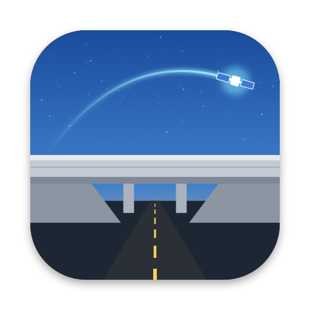
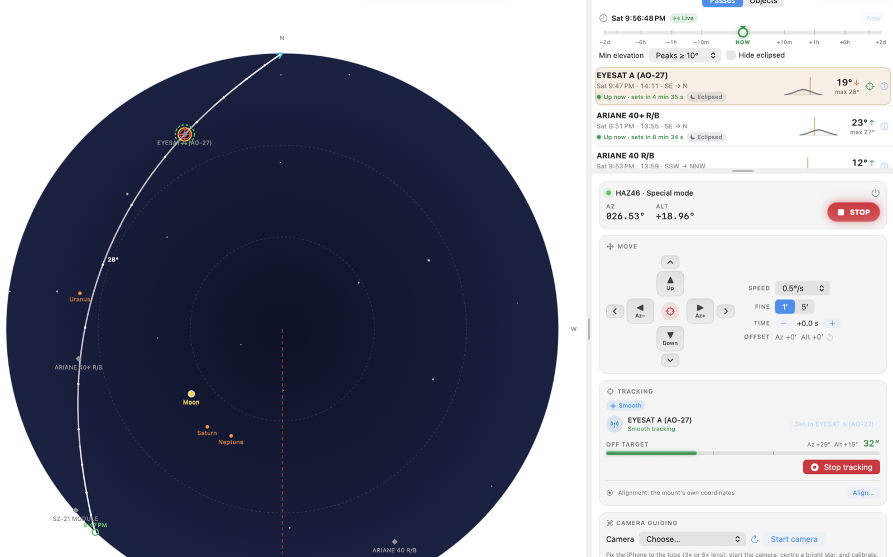

<p align="center"></p>

<h1 align="center">Overpass</h1>

<p align="center">Version 0.4.5 &nbsp;·&nbsp; macOS 14 and iOS 17 &nbsp;·&nbsp; iOptron HAZ and HAE mounts</p>

<p align="center"><a href="https://djsincla.github.io/Overpass/">djsincla.github.io/Overpass</a> &nbsp;·&nbsp; <a href="https://github.com/djsincla/Overpass/releases/latest">Download for Mac</a></p>

For the longest time I have been running Heavenscape SkyTrack on a Windows laptop to drive my iOptron strain-wave mounts. It works, but it meant keeping a Windows machine alive for one job, and that machine was always the one that wanted an update on a clear night. Overpass is the native macOS and iOS replacement: it predicts satellite passes from TLEs, tracks satellites, the Sun, the Moon, planets and bright stars, and drives a HAZ or HAE mount over WiFi or USB.



## What it does

**Passes.** SGP4 prediction from CelesTrak groups, your own URLs or local TLE files, with the age of each source's elements shown so you know when to refresh. Filter by peak elevation, duration, visibility, distance from the Sun and whether the mount can actually keep up. A time bar moves the sky and the pass list up to two days either way, and the mount follows it if you start tracking while it is moved, which is a reasonable way to rehearse a pass in daylight.

**Tracking.** Three modes, depending on how you are connected:

- **Passive** (WiFi or USB Normal mode): one goto, then the mount's own sidereal, lunar or solar rate. Fine for stars, planets, the Moon, the Sun and geostationary satellites, and not offered for any other satellite.
- **Step** (WiFi or USB Normal mode): a goto to where the target will be, repeated every couple of seconds. This is what I used for amateur radio passes for years, and it is fine for an antenna and jumpy in a telescope.
- **Smooth** (USB Special Mode): both axis rates varied about seven times a second against a planned track. On a HAZ46 it settles to a median error of about 2″.

[docs/Tracking-modes.md](docs/Tracking-modes.md) explains Passive and Step in detail: what each sends to the mount, how accurate it is, and what happens at north and when the connection drops.

**Cable stop.** The mount never turns through north, in either hemisphere. The HAZ46's own goto works this way, and Overpass plans every slew and pass to match, going the long way round when it has to. When a pass reaches north the mount stops and Overpass asks whether to unwind and carry on. Over USB there is an option to track up to 90° past north, unwinding when tracking ends. Over-the-top flips are there for passes close to the zenith.

**Sky, globe and map.** The Observe screen switches between the sky overhead, a 3D globe and a flat world map centred on you. The globe and map show up to five passes at once, each with its ground track, the satellite at its real height on the globe and the footprint of the one in focus, with day and night following the Sun. Both are drawn from NASA's Blue Marble and Black Marble images bundled with the app, so they work in a field with no signal.

**Conjunctions.** Space station transits of the Moon and Sun around any place you choose, out to two weeks, drawn on a map with the band where the transit is visible and the time along its centreline. Watch an event and the app refreshes the station elements and recalculates it as the day gets closer, showing how far it moved. This is the one map that uses Apple's MapKit, on purpose: the band is only a few kilometres wide and the transit lasts under a second at any one spot, so you need street-level detail to pick a road or a car park inside it. Each pixel of the bundled world image is about 7 km across, wider than the band. MapKit needs a network connection, so plan conjunctions before you leave; it keeps what you have already looked at.

**Camera tracking.** Click something in the camera image and the mount follows it, for anything with no prediction to go on. In the sky it looks for a spot brighter or darker than the sky around it: a satellite missing from the catalogue, or an aircraft. On the ground it matches the patch you picked by its look, frame to frame, so it holds a boat on the water, a bird against trees, a car or a person. Drag a box around the object for the closest fit. It needs USB Special mode and a calibration, which you can do in daylight on a distant mast or building.

**Also included.** A pass calculator out to fourteen days for any object, star alignment, camera guiding with an iPhone through Continuity Camera, and a red night-vision mode.

## Connecting to the mount

WiFi uses iOptron's normal command set on the mount's own network (10.10.100.254, port 8899 by default) and gives you Passive and Step tracking. USB in Normal mode does the same over the cable.

USB uses iOptron's Special Mode, which only works over the USB port, and gives you Smooth tracking. On a Mac the HAZ46 cable appears as `/dev/cu.PL2303G-USBtoUART210` through Prolific's driver. An iPad with an M1 or later chip uses the same cable through Overpass's own driver for the PL2303G: switch it on in Settings › Overpass › Drivers. An iPhone can't load a USB driver, so it connects over WiFi only.

Be aware that the mount stays in Special Mode across power cycles, and WiFi does not work while it is in it. Overpass puts it back in Normal mode whenever it disconnects, and when the Mac app quits.

## What I found out about the HAZ46

iOptron's Special Mode documentation stops short of a few things that matter, so this is what the mount actually does:

- P0 reads azimuth minus 180°, so its zero faces south, and P1 reads the zenith distance, so it counts down as the tube rises. I found this out when a satellite approaching the horizon had the tube pointing straight up.
- After the mount has been in Special Mode, `:GAC#` in Normal mode reads az 0°, alt 0° until the mount is aligned again, so it cannot be used to calibrate the Special Mode axes.
- After `:ZZZ#` the mount says nothing for about a second while it changes modes, and anything asked in that second times out.
- Every 5 seconds it answers a position request about 15 ms late. At satellite speeds that looks like a 10 to 20″ tracking error if you trust the timestamp of the reply.

The full command set and these notes are in [docs/iOptron-Special-Mode-Protocol.md](docs/iOptron-Special-Mode-Protocol.md).

## Accuracy

Satellite positions come from SGP4 through [SatelliteKit](https://github.com/gavineadie/SatelliteKit), with one correction. SatelliteKit 2.1.2 reads the exponent of the TLE drag term (B*) as a character code, so every satellite had its drag set to about 10⁻⁵², and low orbits ran late by roughly 0.6 s a day after epoch and 200 s after two weeks. That explained a few things. Overpass now reads the TLE columns itself and hands SatelliteKit the right value. The bug is reported upstream as [SatelliteKit #16](https://github.com/gavineadie/SatelliteKit/issues/16), with a one-line fix in [#17](https://github.com/gavineadie/SatelliteKit/pull/17).

I checked the results against two independent sources:

- The reference SGP4 (Vallado's code, as used by Skyfield): positions agree within 10 m for Vanguard 1 and for the ISS a week after its epoch.
- [transit-finder.com](https://transit-finder.com): fourteen ISS and Tiangong transits around Griffith Observatory over two weeks, from the same TLEs, agree within 0.13 s in time, 0.5 km in centreline position and 4% in band width.

Sun, Moon and planet positions follow Meeus's *Astronomical Algorithms* and are checked against his worked examples. None of this makes a TLE more accurate than it is; ISS reboosts move events by seconds, which is why watched conjunctions refresh their elements.

## Status

Tested on a HAZ46: the WiFi connection, Passive tracking of the Moon, Step tracking, USB Special Mode, Smooth tracking at about 2″, the north stop in both hemispheres and reading the mount's GPS position. Not yet tested on hardware: the iOS build, the iPad USB driver, camera guiding, the stop and unwind at north during a real pass, tracking past north over USB, and the fix for the 5 second timing glitch, which I ran out of battery before trying.

## Installing

Download [Overpass.dmg](https://github.com/djsincla/Overpass/releases/latest/download/Overpass.dmg) from the [latest release](https://github.com/djsincla/Overpass/releases/latest), open it and drag Overpass to Applications. It is signed with my Developer ID and notarised by Apple, and needs macOS 14 or later. For iPhone and iPad, [join the TestFlight beta](https://testflight.apple.com/join/nA7S2Nkn) and install it with the TestFlight app. Both are the same version.

## Releasing

`packaging/release.sh` builds, signs with Developer ID, notarises and publishes a Mac release. Bump `MARKETING_VERSION` in `project.yml`, write the notes in `packaging/release-notes/<version>.md`, commit both, then run it; it makes a draft release unless you pass `--publish`, and `--dry-run` stops after building the signed disk image. The comments at the top of the script cover the one-off notarisation setup.

## Building

The Xcode project is generated from `project.yml` and is not committed:

```sh
xcodegen
open Overpass.xcodeproj
```

The app is one multiplatform target (iOS 17+, macOS 14+), signed with team HG979YFABK as `com.djsincla.overpass`. The version is `MARKETING_VERSION` in `project.yml`, with the build number in `CURRENT_PROJECT_VERSION`, and it shows under Settings → About.

## Testing

```sh
swift test
```

160 tests covering the mount protocols, ephemerides, SGP4 against the reference, pass prediction, the mount planner and cable stop, alignment, the conjunction geometry, camera tracking, and the satellite catalogue and search.

## Version history

**0.4.5**, 30 October 2026. The USB relay is gone. An iPhone connects to the mount over WiFi, and so does an iPad for now: Overpass has its own driver for the mount's USB cable on iPads with an M1 or later chip, which reaches TestFlight once Apple approves it.

**0.4.4**, 30 October 2026. Disconnecting, or losing contact with the mount, stops tracking and lets go of the target, so nothing is left set for the next connection. The sky view's rotate and flip buttons sit in a strip above the sky, clear of the horizon. On iPhone the pass calculator's controls wrap to fit the screen.

**0.4.3**, 28 October 2026. On Observe and Look Up, each satellite's name is followed in small type by the TLE source its elements come from, such as Amateur radio, with a count when other sources list it too.

**0.4.2**, 28 October 2026. Look Up on iPhone: the satellite card sits above the tab bar and folds to one line, and in landscape the horizon sits a third of the way up with the phone held level. The sky is drawn over the whole screen, matching the camera picture, which now uses the whole 4:3 sensor.

**0.4.1**, 28 October 2026. Two quick presses of Track could leave a tracking loop running that Stop couldn't reach; a start now gives way to any start or Stop that comes in while it waits on the mount. When the mount and Overpass disagree about where the scope points, Overpass asks which is right, or takes a position typed in, rather than choosing one. Set position works in Normal mode, and a Normal-mode sync waits for the mount to show the new position before checking it.

**0.4.0**, 28 October 2026. Camera tracking on the ground, for boats, birds, cars and people, matched by their look against any background and calibrated in daylight on a mast or building. Step mode slews to a far target in one goto before it starts stepping, and Normal-mode gotos read the position on the way so the scope marker moves with the mount. Clicking a satellite on the globe or map offers the tracking target and its track, asking before it stops another target. The sky view shows a satellite only while it is on a pass the list shows, and the path drawn is always the chosen satellite's.

**0.3.2**, 28 October 2026. Conjunctions follows the location in Settings, searches for places by name with Apple's map search, and on iPhone keeps the full-screen map on its side with a details card that folds away. A metric or imperial choice for every distance and height. The globe drops its orbit line, which smeared high orbits into curves through space.

**0.3.1**, 27 October 2026. The first version on TestFlight for iPhone and iPad as well as a Mac download. North is the HAZ46's cable stop in both hemispheres: tracking stops there and asks before unwinding, and Special mode can track up to 90° past it and unwind afterwards. Globe and world map views that work offline, with up to five tracks. The mount's GPS location. Look up on iPhone and iPad. Exposure and gain for USB guide cameras such as the iPolar. Conjunctions search by satellite name. Stop leaves the mount's own tracking running, the mount's tracking is turned off on connect, and disconnecting always returns the mount to Normal mode.

**0.3.0**, 25 October 2026. Normal mode over USB, switching between Normal and Special mode without disconnecting, syncing that copes with the HAZ46's placeholder position after a mode switch, sync on the target in both modes, Passive tracking that watches the mount, a Normal-mode update setting, and a sky view you can spin and flip.

**0.2.0**, 25 October 2026. Smooth tracking speeds without the once-a-second step, a tracking update period from 0.05 to 2 s, native slews that respect how the HAZ46 counts azimuth across north, and satellite details in sortable columns from CelesTrak's catalogue and GCAT, with attribute search.

**0.1.0**, 24 October 2026. First version: pass prediction and filtering, Passive, Step and Smooth tracking, the cable stop, star and mount alignment, the time bar, the pass calculator, conjunctions, camera guiding and night vision, tested on a HAZ46.

## Licence

Overpass is released under the [Apache License 2.0](LICENSE). It uses [SatelliteKit](https://github.com/gavineadie/SatelliteKit) by Gavin Eadie under the MIT License; see [NOTICE](NOTICE).

Nothing here is supported by iOptron, and a mount that slews into its own tripod is still your problem. Read the cable stop section of the settings before you trust it with your cabling.
